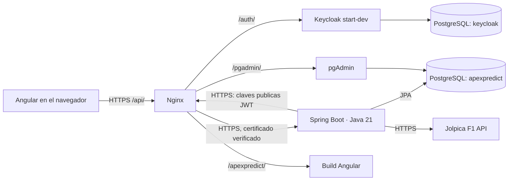

# ApexPredict · DACS 2026

Plataforma de predicciones de Formula 1 (nombre alternativo: PoleProde).
Las fases 1 a 4 tienen infraestructura ejecutable, backend Spring Boot y cliente
Angular con autenticacion real. Los alcances no especificados por la consigna se
documentan aqui; no se recibio otra guia de la catedra.

## Arranque habitual

Desde PowerShell en la raiz del proyecto:

```powershell
powershell -NoProfile -ExecutionPolicy Bypass -File .\start.ps1
```

El script inicia Docker Desktop, instala dependencias cuando hace falta, compila,
levanta los servicios, configura Keycloak y verifica el entorno. Abrir
**https://dacs2026.local/apexpredict/** y pulsar **Crear cuenta**, o ingresar a
**Iniciar sesion > Registrarse**, para crear un perfil propio con rol `player`.

**Guia completa:** [inicializacion, cuentas, desarrollo y solucion de problemas](docs/arranque.md).
Usar `start.ps1 -Dev` para agregar Angular en el puerto 4200 y `-Demo` para crear
las cuentas de las pruebas automatizadas.

La raiz del dominio redirige a esa
ruta. El parametro `/nombre-app/` de la consigna se concreta como `/apexpredict/`.
El cliente de Keycloak se actualiza mediante su API porque `--import-realm` omite
realms ya existentes; no se borran los volumenes de la Fase 1.

Si npm 11.0.0 falla al resolver dependencias, utilizar la version fijada sin
modificar la instalacion global:

```powershell
npm exec --yes --package=npm@11.6.2 -- npm ci
```

## Arquitectura cliente-servidor



Nginx publica solamente `127.0.0.1:80`, `127.0.0.1:443` y `127.0.0.1:8080`.
El puerto 80 redirige a HTTPS. El BFF escucha en **8443 con TLS** dentro de Docker:
no se publica directamente en Windows. Nginx elimina `/api` antes de reenviar,
verifica el certificado del BFF y conserva la query string.

Keycloak mantiene `/auth/` en ambos lados del proxy. Su HTTP interno corresponde
al modo `start-dev` solicitado; el acceso del navegador siempre es HTTPS.
Las bases y roles `apexpredict` y `keycloak` estan separados en la red interna
`data`. El navegador no accede a PostgreSQL ni recibe sus credenciales.

## Backend: Spring Boot 4.0.8 y Java 21

`backend/bff` usa Maven con Web MVC, Data JPA, PostgreSQL, Security, OAuth2 Resource
Server, Validation y Flyway. El wrapper fija Maven 3.9.11. El build Docker compila
y ejecuta las pruebas con Java 21, aunque Windows conserve el Java usado en Fase 1.

```text
src/main/java/ar/edu/dacs/apexpredict/
  domain/                       Entidades y reglas del modelo
  application/                  Casos de uso y puerto F1DataProvider
  infrastructure/persistence/   Repositorios Spring Data
  infrastructure/f1/            JolpicaAdapter
  security/                     JWT, roles y CORS
  web/                          Controladores, DTO y errores
src/main/resources/db/migration/V1__domain.sql
```

| Entidad | Relacion / restriccion |
| --- | --- |
| `User` | Identidad externa unica por issuer + subject; sin contrasenas locales |
| `League` | Propietario `User`, codigo de invitacion unico |
| `LeagueMember` | Une usuario y liga; pertenencia unica por pareja |
| `Session` | Temporada, ronda, tipo, fecha y horario opcional |
| `Prediction` | Un podio por miembro y sesion; tres pilotos distintos, cierre antes del inicio |
| `SessionResult` | Una clasificacion ordenada por sesion, sin pilotos duplicados |

Flyway versiona el esquema; Hibernate usa `ddl-auto: validate` y nunca modifica
tablas automaticamente. Las colecciones de posiciones estan en tablas auxiliares.
La regla inicial de prediccion es un podio de tres pilotos; la puntuacion y otras
reglas del prode quedan pendientes de una especificacion funcional.

`JolpicaAdapter` obtiene calendarios y resultados por HTTPS, con tiempos limite,
paginacion acotada y respuestas normalizadas mediante `F1DataProvider`. Un proveedor
caido devuelve 502; una carrera sin resultados devuelve una lista vacia. Un horario
no publicado queda `null`, sin inventar una hora de cierre. Las consultas no importan
automaticamente carreras a PostgreSQL: el proceso de sincronizacion es una fase posterior.

| Endpoint externo | Acceso / comportamiento |
| --- | --- |
| `GET /api/health` | Publico: estado del BFF |
| `GET /api/calendar/{season}` | Publico: calendario Jolpica |
| `GET /api/results/{season}/{round}` | Publico: clasificacion Jolpica |
| `PUT /api/me` | player/admin: crea o actualiza el perfil de forma idempotente |
| `GET /api/leagues` | player/admin: solo las ligas del usuario autenticado |
| `POST /api/leagues` | player/admin: crea liga y pertenencia OWNER en una transaccion |
| `GET /api/admin/status` | Solo admin: comprueba la autorizacion |

La identidad se extrae del JWT, nunca de un `userId` proporcionado por el cliente.
El esquema contempla las seis entidades; no se han implementado todavia los CRUD
completos, invitaciones, carga de pronosticos ni calculo de puntos.

## Seguridad y Keycloak

Se usa Authorization Code con PKCE S256 y JWT Bearer, sin cookies de autenticacion
propias del BFF. El cliente `apexpredict-web` es publico, sin client secret y sin
password grant. Los mappers de audiencia agregan `apexpredict-bff` y
`apexpredict-backend` al access token.

Spring valida firma RS256, vencimiento, issuer
`https://dacs2026.local/auth/realms/apexpredict` y audiencia. Convierte unicamente
los roles de realm `player` y `admin`. Sin token responde 401; sin rol responde 403.
CORS permite los origenes locales concretos configurados; no usa comodines.
CSRF esta deshabilitado porque los endpoints privados usan exclusivamente Bearer
en una API stateless. Si se cambia a cookies, debe revisarse esa decision.

El contenedor Java incorpora el certificado local en una copia temporal de su
truststore y conserva las CA publicas para Jolpica. No se deshabilita la validacion
TLS. La clave PKCS#12 se monta en modo de solo lectura y su password llega por `.env`.

## Frontend: Angular 21.2.24 standalone

Se eligio Angular 21 por compatibilidad con Node 24.14.1. Se incluyen
`keycloak-angular` 21.0.0 y `keycloak-js` 26.2.4, con `package-lock.json` versionado.

```text
frontend/apexpredict/src/app/
  core/auth/        AuthService, requireRole
  core/http/        authInterceptor y validacion de URL destino
  core/models/      DTO del cliente
  core/services/    ApiService
  features/home/             Calendario publico
  features/dashboard-view/   Perfil y ligas
  features/admin/            Acceso de administrador
  features/forbidden/        Acceso denegado
  app.config.ts
  app.routes.ts
```

Las pantallas se cargan mediante `loadComponent`; no importan otras pantallas.
`core` no depende de `features`. `scripts/check-frontend-boundaries.mjs` verifica
estas reglas. `app.config.ts` registra Keycloak, el inicializador y `authInterceptor`
con `provideHttpClient(withInterceptors(...))`.

La proteccion tiene tres capas:

1. **UI:** los enlaces privados se muestran segun los roles.
2. **Router:** `requireRole()` exige login y roles al acceder por URL.
3. **BFF:** Spring Security vuelve a validar token y permisos.

El interceptor renueva el token antes de las peticiones y lo agrega solo a la API
configurada, comprobando origen y frontera de ruta. Los tokens quedan en memoria;
no se guardan en localStorage. El frontend muestra errores de disponibilidad sin
simular una sesion autenticada.

## Desarrollo con ng serve

Con la infraestructura levantada y `configure-keycloak.mjs` ejecutado:

```powershell
cd frontend/apexpredict
npm start
# Equivale a ng serve: http://localhost:4200/
```

Los environments respetan los valores solicitados:

| Archivo | production | apiUrl |
| --- | --- | --- |
| `environment.development.ts` | false | `http://localhost:8080/api` |
| `environment.ts` (Vercel) | true | `https://dacs-2-crv9.onrender.com/bff` |
| `environment.local.ts` (Nginx local) | true | `https://dacs2026.local/api` |

El build de Vercel usa `npm run build` (produccion). `start.ps1` combina
`--configuration=production,local --base-href=/apexpredict/` para conservar el
BFF y Keycloak locales. No publicar el build de Vercel en Nginx local.

Configuracion concreta de Keycloak/Render, evidencia y pasos pendientes del
despliegue publico: [docs/despliegue-publico.md](docs/despliegue-publico.md).

`architect.build.configurations.development.fileReplacements` selecciona el archivo
local. Para compatibilizar el HTTP literal de la consigna con el requisito de TLS,
el interceptor lo convierte a **`https://localhost:8080/api` antes de enviar la
solicitud o adjuntar el JWT**. Nginx escucha con TLS en ese puerto. No se envian
tokens por HTTP ni se depende de una redireccion posterior.

`ng serve` usa HTTP solo para servir codigo en loopback. Las llamadas a la API y
Keycloak son HTTPS. Tambien se puede ejecutar el frontend con TLS:

```powershell
npm start -- --ssl --ssl-cert ../../infra/certs/generated/dacs2026.local.pem --ssl-key ../../infra/certs/generated/dacs2026.local.key
```

Keycloak acepta callbacks tanto `http://localhost:4200/*` como
`https://localhost:4200/*`, y `https://dacs2026.local/apexpredict/*` en produccion local.

## Credenciales y accesos

| Recurso | Acceso |
| --- | --- |
| Aplicacion compilada | https://dacs2026.local/apexpredict/ |
| Desarrollo | http://localhost:4200/ |
| Keycloak Admin | https://dacs2026.local/auth/admin/ |
| pgAdmin | https://dacs2026.local/pgadmin/ |
| Credenciales de infraestructura | `.env` |
| Cuentas de prueba | `.local/dev-users.json` |

`configure-keycloak.mjs --demo` crea `demo-player`, `demo-admin` y `demo-observer`
con contrasenas aleatorias y roles diferenciados. Se conservan al repetir el setup.
No se reemplazan cuentas ajenas con esos nombres. Sin `--demo`, solo se configura
el cliente, el registro local y el rol predeterminado `player`. Las cuentas propias
se crean desde **Registrarse** en el login o **Crear cuenta** en la portada. La
contrasena requiere al menos 10 caracteres; el perfil se guarda al entrar a Mis ligas.
No se envian correos de verificacion ni recuperacion porque no hay SMTP configurado.

pgAdmin usa `PGADMIN_EMAIL` y `PGADMIN_PASSWORD`. La conexion precargada es
`postgres:5432`, base/usuario `apexpredict`, password `APP_DB_PASSWORD`.
El bootstrap admin de Keycloak (`KEYCLOAK_ADMIN`) pertenece al realm `master`,
y no debe utilizarse como jugador de la aplicacion.

## Inicializacion de una maquina nueva (Fase 1)

Requisitos: Docker Desktop Linux, Node 22.12+ o 24+, OpenSSL (se detecta el de Git),
y Java con `keytool`. Para compilar fuera de Docker se requiere JDK 21 y `JAVA_HOME`.

```powershell
powershell -NoProfile -ExecutionPolicy Bypass -File scripts/setup-env.ps1
.\make-cert.bat
.\export-to-pem.bat
.\export-to-p12.bat
.\export-p12-to-jks.bat
```

Luego, en PowerShell como administrador:

```powershell
powershell -NoProfile -ExecutionPolicy Bypass -File scripts/setup-hosts.ps1
.\import-to-java.bat
```

Se agrega `127.0.0.1 dacs2026.local` a hosts y el certificado a `cacerts` del Java
seleccionado (`JAVA_HOME` o `-JavaHome`). Los originales quedan en `.local/backups/`.
El certificado tiene SAN para el dominio, localhost y 127.0.0.1; vigencia de 365 dias.
Las claves existentes se conservan al repetir los scripts.

La confianza de Java es independiente de Windows. Para confiar en el certificado
autofirmado de este proyecto en el navegador del usuario actual:

```powershell
powershell -NoProfile -ExecutionPolicy Bypass -File scripts/trust-browser-cert.ps1
```

Windows puede mostrar una advertencia de seguridad que debe aceptarse para terminar
la importacion. El script no modifica el almacen de toda la maquina. Los tests Node
usan directamente el PEM y verifican TLS sin `-k` ni `rejectUnauthorized: false`.

## Pruebas y operacion

Resultados de esta ejecucion y el estado de la prueba visual:
[docs/validation.md](docs/validation.md).

```powershell
docker compose config --quiet
docker compose exec -T nginx nginx -t
node scripts/check-frontend-boundaries.mjs
node scripts/smoke-test.mjs
node scripts/integration-test.mjs
cd frontend/apexpredict
npm test -- --watch=false
cd ../../backend/bff
.\mvnw.cmd verify  # requiere JDK 21; Docker tambien ejecuta verify durante el build
```

Las pruebas incluyen firmas JWT adulteradas, audiencia/issuer/vencimiento, roles,
CORS, reglas de prediccion, contrato del adaptador, interceptores y guards.
La integracion usa Authorization Code + PKCE real y comprueba persistencia,
aislamiento de ligas, roles y consultas a Jolpica. Requiere las cuentas `--demo` y
deja una liga de prueba identificada como `Liga de verificacion DACS`.

```powershell
docker compose ps
docker compose logs --tail 80 bff nginx keycloak
docker compose stop
docker compose start --wait
docker compose down  # conserva los volumenes
```

No usar `down -v` para aplicar cambios: borra los datos. Los scripts de PostgreSQL
solo inicializan volumenes vacios; Flyway aplica las migraciones posteriores.
Cambiar `.env` no rota las contrasenas ya persistidas. `.env`, certificados privados,
cuentas de prueba, caches, builds y reportes locales estan excluidos de Git.

Este es el entorno local de la consigna. Keycloak `start-dev`, las cuentas demo y
los certificados autofirmados requieren otra configuracion para un despliegue publico.

## Referencias

- [Angular: compatibilidad de versiones](https://angular.dev/reference/versions).
- [Keycloak Angular: configuracion standalone y compatibilidad](https://github.com/mauriciovigolo/keycloak-angular).
- [Spring Security: validacion JWT](https://docs.spring.io/spring-security/reference/servlet/oauth2/resource-server/jwt.html).
- [Jolpica: API y documentacion de endpoints](https://github.com/jolpica/jolpica-f1).
- [Keycloak: reverse proxy](https://www.keycloak.org/server/reverseproxy).
- [Nginx: proxy_pass](https://nginx.org/en/docs/http/ngx_http_proxy_module.html#proxy_pass).
